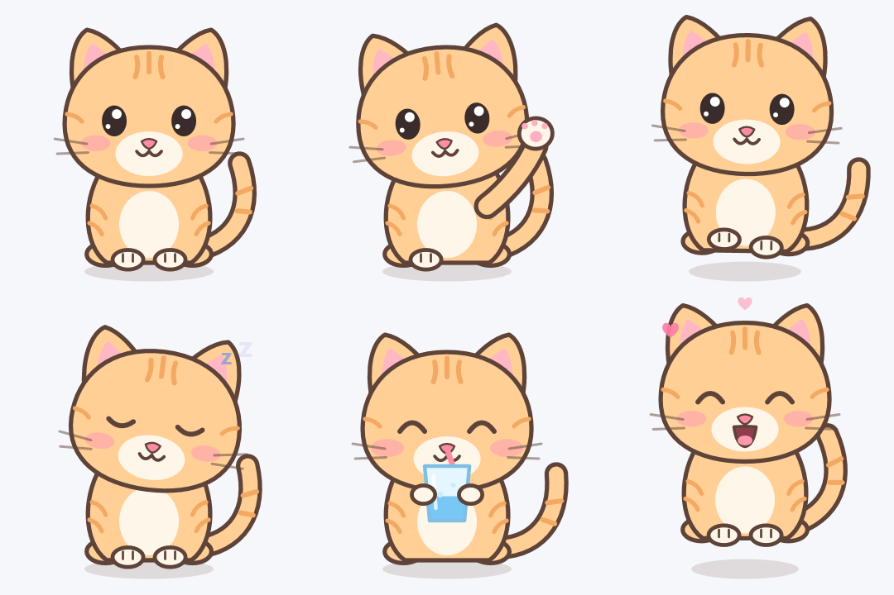
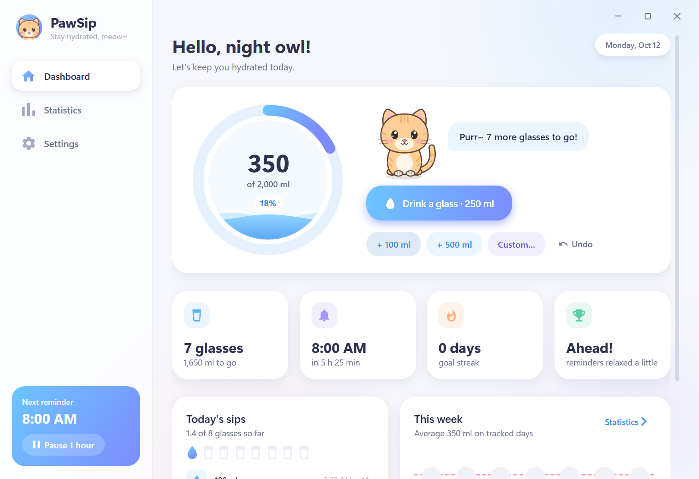

<p align="center">
  
</p>

<h1 align="center">PawSip</h1>

<p align="center">
  <b>A cute desktop cat that keeps you hydrated.</b><br/>
  A tiny water-reminder app for Windows: an animated cat lives on your desktop, tracks your daily water
  and asks you to drink at the right moments, without ever getting in your way.
</p>

<p align="center">
  <a href="#download"><b>⬇ Download PawSip for Windows</b></a>
  &nbsp;·&nbsp; Windows 7, 8, 10 and 11 &nbsp;·&nbsp; free, no account, works offline
</p>

<p align="center">
  
</p>

---

## Why PawSip?

Most reminder apps nag you with plain pop-ups that you learn to ignore. PawSip gives you a little companion
instead: a ginger cat that naps on your desktop, wakes up when it's time to drink, waves at you, meows, and
sips a glass of water with you when you do. It's charming, but it's also built to stay out of your way.
It never steals keyboard focus, waits while you're in a fullscreen game, video or presentation, and stays
quiet outside your active hours.

## Features

### 🐱 Your desktop cat
- **Desktop widget.** The cat sits on your desktop with a water gauge (`1,250 / 2,000 ml`). Hover it to log
  a glass, undo the last drink, or open the app.
- **Reminders right where it sits.** At reminder time the cat wakes up, waves, meows and asks:
  **I drank water**, **Remind me later** (5, 10, 15, 30 min or 1 hour), or **Dismiss**.
- **Fully animated.** It blinks, looks around, twitches its ears, waves, walks, naps with floating *Zzz*,
  drinks through a straw and celebrates with hearts. Click it to pet it.
- **Draggable.** Put it anywhere; it remembers the spot. Choose **Small** (default), **Medium** or **Large**.
- **Right-click menu.** Drink, undo, "remind me in…", cat size, keep on top, hide.
- **Calm by design.** Between reminders it naps. If you ignore a reminder it curls up and stops asking.

### 💧 Daily goal
- Set your goal in **glasses or milliliters** and choose your glass size (150–1000 ml).
- An animated **water ring** fills up as you drink.
- Log a glass with one click, or add 100 ml, 500 ml or any custom amount. Undo mistakes.
- **Resets automatically at midnight.** Every day is kept in your history.

### ⏰ Smart reminders
- **Follows you, not the clock.** Whenever you're at the PC (screen on, unlocked, keyboard or mouse in use),
  the cat can remind you, any time of day. While you're away, the screen is off or the PC is locked, it
  waits, and greets you with a "Welcome back!" reminder as soon as you return.
- **Doesn't give up.** Dismiss or ignore a reminder without drinking and the cat comes back after
  **15 minutes**, again and again, until you've had some water. It gets a little more insistent each time.
- Remind every **20, 30, 45, 60, 90 or 120 minutes**.
- **Smart timing.** Reminders come a bit more often when you're behind on your goal and relax when you're
  ahead. Once you hit your goal the cat rests until tomorrow (optional).
- **Your day** (for example 8:00 AM – 10:00 PM) paces your goal. Prefer strict quiet hours? Turn off
  "Remind me whenever I'm using my PC" and reminders only come inside those hours.
- **Never interrupts** fullscreen apps, games, videos or presentations.
- Pause for 30 min, 1 hour, 2 hours or until tomorrow from the tray.

### 📊 Dashboard and statistics
- Dashboard with today's intake, remaining glasses, next reminder, goal streak and today's pace.
- Timeline of today's sips and a weekly chart.
- **Weekly and monthly statistics.** Daily average, days the goal was met, best day, total liters, and a
  monthly hydration calendar.

<p align="center">
  
</p>

### ⚙️ Runs quietly in the background
- **Starts with Windows** (can be turned off) and lives in the system tray.
- Keeps reminding you when the window is closed.
- Light on resources: about **65 MB** of memory with the desktop cat on screen (about 25 MB tray-only) and
  well under **1% CPU**. A tiny check runs every 20 seconds, and the cat animates at a gentle frame rate only
  while it's visible.
- Your preferences, progress and reminder schedule are restored after a restart.
- **Keeps itself up to date** (from 1.0.2): a quick daily check offers new versions and installs them with one
  click. See [Updates](#updates).

### 🔊 Sounds
- A soft synthesized **meow** (default), a chime, a water drop, or silence, with adjustable volume.

## Download

Pick the installer for your PC. Not sure? Most PCs need the first one.

| Your Windows | Download | Size |
|---|---|---|
| **Windows 10 / 11**, 64-bit (Intel or AMD), most PCs | [PawSip-Setup-1.0.2-x64.exe](release/PawSip-Setup-1.0.2-x64.exe) | 48.5 MB |
| **Windows 11 / 10 on ARM** (Snapdragon, Surface Pro X…) | [PawSip-Setup-1.0.2-arm64.exe](release/PawSip-Setup-1.0.2-arm64.exe) | 42.6 MB |
| **Windows 10**, 32-bit | [PawSip-Setup-1.0.2-x86.exe](release/PawSip-Setup-1.0.2-x86.exe) | 44.1 MB |
| **Windows 7 SP1 / 8.1** (32- or 64-bit; Windows 8 needs the free 8.1 update) | [PawSip-Setup-1.0.2-win7-8.exe](release/PawSip-Setup-1.0.2-win7-8.exe) | 2.5 MB |

- The Windows 10/11 installers include everything they need. The Windows 7/8 edition uses Microsoft
  **.NET Framework 4.8**, which most of those PCs already have from Windows Update; setup tells you if it's
  missing.
- Find your Windows version and type in *Settings › System › About* (Windows 7/8: *Control Panel › System*).
- SHA-256 checksums: [release/SHA256SUMS.txt](release/SHA256SUMS.txt).
- The installers aren't code-signed yet, so Windows SmartScreen may say *"Windows protected your PC"*.
  Click **More info › Run anyway**.

## Install

1. Run the installer. No admin rights needed; it installs just for your user account.
2. Keep **Start PawSip with Windows** ticked so your cat is always there.

Installing a newer version, or another edition, replaces the one you have; your history and settings are kept.
Uninstall from *Settings › Apps*. Your history stays in `%APPDATA%\PawSip` in case you reinstall.

## Updates

From version 1.0.2 PawSip keeps itself up to date:

- About 30 seconds after it starts, and then at most once every 24 hours while it runs, it downloads the
  update feed [`https://www.nomanshafiq.com/updates/pawsip.json`](https://www.nomanshafiq.com/updates/pawsip.json).
  A failed check (offline, server down) is silent and tried again later.
- If the feed lists a newer version, it's offered in a card at the top of the dashboard: **Update now**,
  **Later** or **Skip this version**. While the window is closed, a tray notification tells you instead (click
  it to open the card). It never pops up over a fullscreen game, video or presentation, or while you're away;
  it waits for a better moment.
- **Update now** downloads the installer for your edition (Windows 10/11 x64, ARM64 or 32-bit, or
  Windows 7/8.1) to `%TEMP%\PawSip-Update`, showing the progress, and checks its size and SHA-256 against the
  feed; a file that doesn't match is deleted and never run. Then PawSip runs the installer silently, just for
  your user account (no admin prompt), and exits. The installer replaces the old version in place, removing
  files it no longer uses, keeps your data in `%APPDATA%\PawSip` and your "Start with Windows" choice, and
  starts PawSip again in the tray. The downloaded installer is removed the next time PawSip starts.
- **Settings › Updates** has **Check for updates** (it also offers a version you skipped) and
  **Check for updates automatically** to turn the daily check off. The tray menu has **Check for updates…**
  too, and shows **Update to PawSip x.y.z…** while an update is waiting.
- Privacy: the check is an ordinary HTTPS request for that JSON file, with `PawSip/<version>` as its user
  agent. Nothing else is sent: no ID, no usage data, nothing about your water or your settings.
- Versions 1.0.0 and 1.0.1 don't have the updater: install 1.0.2 over them once.

For testing, the environment variable `PAWSIP_UPDATE_URL` points PawSip at another feed (an `http(s)://`
address or a file path); only then may installer links use plain HTTP.

## Tips

| Where | What you can do |
|---|---|
| Desktop cat | Hover: drink a glass, undo, open the app · Right-click: remind me in…, cat size, keep on top · Drag: move it · Click: pet it |
| Reminder bubble | **I drank water** · **Remind me later** (pick the time) · ✕ dismiss |
| Tray icon | Open, log a glass, remind me now, show or hide the desktop cat, pause or resume reminders, check for updates, exit |
| Settings | Goal and glass size, interval, activity-based reminders, your day's hours, smart timing, "ask again" time, snooze length, fullscreen behaviour, desktop cat, cat style and size, animations, sound and volume, updates, start with Windows |

## Privacy

Everything stays on your PC in `%APPDATA%\PawSip\pawsip.json`. There are no accounts and no tracking. The only
network access is the update check described in [Updates](#updates), which sends nothing about you and can be
turned off in *Settings › Updates*.

## Build from source

Requirements: [.NET 10 SDK](https://dot.net) and [Inno Setup 6](https://jrsoftware.org/isdl.php) (for the installer).

```powershell
powershell -ExecutionPolicy Bypass -File build.ps1                   # all four installers -> dist\
powershell -ExecutionPolicy Bypass -File build.ps1 -Editions x64     # just one edition
powershell -ExecutionPolicy Bypass -File build.ps1 -SkipInstaller    # apps only -> publish\<edition>
```

One codebase, two targets: **.NET 10** (Windows 10/11, published self-contained for x64, ARM64 and x86,
so the PC doesn't need .NET installed) and **.NET Framework 4.8** (Windows 7 SP1 / 8.1).

### Project structure

```
src/PawSip/
  Core/       Hydration tracking, smart reminder scheduler, storage, startup, updater, synthesized sounds
  Controls/   The animated vector cat, water ring, bar chart, month calendar, stepper
  Views/      Dashboard, statistics, settings, desktop widget, reminder cat, tray icon
  Themes/     Pastel theme: colors, icons, buttons, switches, chips
  Interop/    Windows helpers (fullscreen and idle detection, non-activating windows)
installer/    Inno Setup script
tools/        Icon builder
```

Built with C# and WPF on .NET 10. The cat is drawn entirely with vector shapes, so it stays crisp at any
size and DPI.

---

<p align="center">Made with 💧 and 🐾 by <a href="https://github.com/MuhammadNoman76">Muhammad Noman</a></p>
